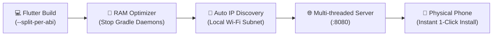

<div align="center">

# 🚀 Flutter APK Wi-Fi Distributor & RAM Optimizer

**Instant, cable-free Flutter APK distribution over local Wi-Fi with automated Windows RAM recovery.**

[](LICENSE)
[](#installation)
[](https://flutter.dev)
[](#)

<br/>

[Features](#-features) • [The Problem](#-the-problem) • [Quick Start](#-quick-start) • [How It Works](#-how-it-works) • [Antigravity AI Plugin](#-antigravity-ai-plugin) • [CLI Reference](#-cli-options)

</div>

---

## 😫 The Problem

Every Flutter developer faces two major workflow bottlenecks during day-to-day testing on physical devices:

1. **Gradle RAM Hogging:** Following Android compilation, background Gradle and Java daemon processes hold **4 GB to 8 GB+ of RAM** hostage on your machine. Windows does not automatically free this memory.
2. **Device Transfer Friction:** Physical USB cables are clumsy, ADB over Wi-Fi disconnects constantly, and uploading 40 MB binaries to Google Drive, WhatsApp, or cloud storage wastes bandwidth and time.

---

## 💡 The Solution

**`flutter-apk-wifi-distributor`** automates this entire lifecycle into a single command:

1. ⚡ **Compiles lean Split APKs** (`--split-per-abi`) to cut download sizes by ~60%.
2. 🧹 **Immediately terminates Gradle daemons** (`.\gradlew --stop`) and flushes process working sets to reclaim gigabytes of system RAM.
3. 📶 **Auto-detects your local Wi-Fi IP** and launches an embedded, zero-config HTTP server hosting a sleek dark-mode mobile download portal.
4. 📱 **One-tap phone download:** Just open the local link on your mobile browser (or scan QR) to download and install at full local Wi-Fi speeds without consuming mobile data.

---

## 🔄 How It Works



---

## 🚀 Quick Start

### 1. Installation

#### Option A: Install globally via pip
```bash
git clone https://github.com/chamodrashmith/flutter-apk-wifi-distributor.git
cd flutter-apk-wifi-distributor
pip install -e .
```

#### Option B: Windows PowerShell One-Click
Run inside the repository:
```powershell
.\bin\install.ps1
```

---

### 2. Usage in Any Flutter Project

Navigate to your Flutter app directory and run:

```bash
# Build split APKs, clean RAM, and host over Wi-Fi:
apk-distribute --build

# Or if you already have a built APK and just want to share & free RAM:
apk-distribute
```

When started, your terminal displays:

```text
=================================================================
🚀 FLUTTER APK WI-FI DISTRIBUTION SERVER ONLINE
=================================================================
📱 Phone Portal URL : http://192.168.8.154:8080
⬇️ Direct Download  : http://192.168.8.154:8080/app-release.apk
=================================================================
👉 Open the URL on your mobile browser (connected to same Wi-Fi).
👉 Press Ctrl+C in this terminal when finished to stop & free memory.
```

---

## 📱 Mobile Web Portal Preview

Opening `http://<YOUR_IP>:8080` on your phone displays a clean, responsive mobile portal:

```text
┌──────────────────────────────────────────┐
│                   🚀                     │
│               My Flutter App             │
│   Direct Wi-Fi transfer ready. No data.  │
│                                          │
│       ┌──────────────────────────┐       │
│       │   ⬇️ Download APK Now    │       │
│       └──────────────────────────┘       │
│                                          │
│         [📦 37.4 MB]   [⚙️ ARM64]         │
└──────────────────────────────────────────┘
```

---

## ⚙️ CLI Options

| Flag | Default | Description |
| :--- | :---: | :--- |
| `--build` | `False` | Triggers `flutter build apk --split-per-abi --release` before serving. |
| `--no-split` | `False` | Builds universal fat APK instead of ABI splits. |
| `--clean-ram` | `True` | Stops lingering Gradle daemons and trims Windows memory working sets. |
| `--port <port>` | `8080` | Initial port to bind (automatically tries next available ports if busy). |
| `--type <abi>` | `arm64` | Target ABI to distribute (`arm64`, `arm32`, `x86_64`, `universal`). |

---

## 🤖 Antigravity AI Plugin

This repository includes a ready-to-use **Antigravity AI Plugin** bundle inside `plugin/`. 

To install it into your local Antigravity environment:
```powershell
Copy-Item -Recurse -Force "plugin" "$HOME\.gemini\config\plugins\flutter-apk-wifi-distributor"
```

Once installed, simply ask Antigravity:
> *"Build split APKs and share to my phone over Wi-Fi"*  
> *"Clean Gradle RAM and distribute the latest APK to my mobile"*

---

## 📄 License

This project is open-source and available under the [MIT License](LICENSE).

Developed with ❤️ by **Chamod Rashmith**.
