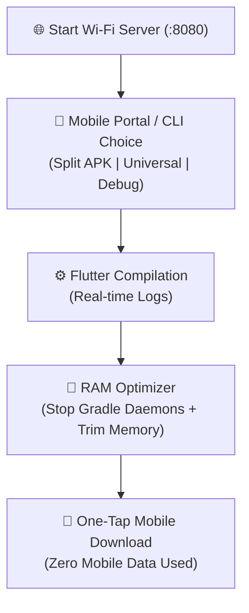

<div align="center">

# 🚀 Flutter APK Wi-Fi Distributor & RAM Optimizer

**Instant, cable-free Flutter APK distribution over local Wi-Fi with on-demand package building and automated Windows RAM recovery.**

[](LICENSE)
[](#installation)
[](https://flutter.dev)
[](#)
[](https://ko-fi.com/C0C818ICQE)

<br/>

[Features](#-features) • [The Problem](#-the-problem) • [Quick Start](#-quick-start) • [How It Works](#-how-it-works) • [Antigravity AI Plugin](#-antigravity-ai-plugin) • [CLI Reference](#-cli-options)

</div>

---

## 😫 The Problem

Every Flutter developer faces two major workflow bottlenecks during day-to-day testing on physical devices:

1. **Gradle RAM Hogging:** Following Android compilation, background Gradle and Java daemon processes hold **4 GB to 8 GB+ of RAM** hostage on your machine. Windows does not automatically free this memory.
2. **Device Transfer Friction:** Physical USB cables are clumsy, ADB over Wi-Fi disconnects constantly, and uploading 40 MB binaries to Google Drive, WhatsApp, or cloud storage wastes bandwidth and time.

---

## 💡 The Solution

**`flutter-apk-wifi-distributor`** unifies build selection, RAM recovery, and wireless distribution into one smooth experience:

1. 🌐 **Launch Server First:** Start the distribution server immediately—no need to compile beforehand!
2. 🎯 **On-Demand Package Selection:** Choose what to build right from your mobile phone browser or terminal:
   - ⚡ **Split APKs (Release):** Compiles `arm64-v8a`, `armeabi-v7a`, `x86_64` (cuts file size by ~60%).
   - 📦 **Universal Release APK:** Single fat APK for all architectures.
   - 🐞 **Debug APK:** Fast unoptimized compilation for quick testing.
3. 🧹 **Automated RAM Reclamation:** Automatically terminates lingering Gradle daemons (`.\gradlew --stop`) and flushes Windows working set memory right after compilation and upon shutdown.
4. 📶 **Auto-detected Local Wi-Fi:** Detects your machine's local IPv4 address and hosts an embedded, dark-mode, mobile-first web portal on port `8080`.
5. 📱 **Multi-Package Download Cards:** Displays all compiled APKs with direct one-tap download buttons, file sizes, and architecture badges.

---

## 🔄 How It Works



---

## 🚀 Quick Start (One-Line Install)

Run the single-line command for your operating system to install both the global `apk-distribute` CLI and the Antigravity AI Plugin:

### Windows (PowerShell)
```powershell
git clone https://github.com/chamod-rashmith/flutter-apk-wifi-distributor.git; cd flutter-apk-wifi-distributor; powershell -ExecutionPolicy Bypass -File .\bin\install.ps1
```

### Windows (CMD)
```cmd
git clone https://github.com/chamod-rashmith/flutter-apk-wifi-distributor.git && cd flutter-apk-wifi-distributor && powershell -ExecutionPolicy Bypass -File .\bin\install.ps1
```

### macOS / Linux (Bash)
```bash
git clone https://github.com/chamod-rashmith/flutter-apk-wifi-distributor.git && cd flutter-apk-wifi-distributor && chmod +x ./bin/install.sh && ./bin/install.sh
```

> [!TIP]
> The installer automatically:
> 1. Installs the command-line tool `apk-distribute` via `pip`.
> 2. Deploys the complete AI Plugin into your local Antigravity environment (`$HOME/.gemini/config/plugins/flutter-apk-wifi-distributor`) so coding agents can trigger it automatically!

---

### 2. Usage in Any Flutter Project

Navigate to your Flutter app directory and run:

```bash
# Workflow 1: Launch server first and select/build directly from your phone!
apk-distribute --server

# Workflow 2: Interactive terminal menu
apk-distribute

# Workflow 3: Direct compilation shortcuts
apk-distribute --split       # Build split APKs & launch server
apk-distribute --universal   # Build universal release APK & launch server
apk-distribute --debug       # Build debug APK & launch server
apk-distribute --clean-ram   # Only reclaim Windows RAM & stop Gradle daemons
```

When started, your terminal displays:

```text
====================================================================
🚀 FLUTTER APK WI-FI DISTRIBUTION SERVER ONLINE
====================================================================
📦 Flutter Project   : My Flutter App
📱 Phone Portal URL  : http://<LOCAL_WIFI_IP>:8080
⬇️ Direct Download   : http://<LOCAL_WIFI_IP>:8080/download/app-arm64-v8a-release.apk
====================================================================
👉 Open the URL on your mobile browser (connected to same Wi-Fi).
👉 You can select & trigger compilation directly from the Mobile Web Portal!
👉 Press Ctrl+C in this terminal when finished to stop & free memory.
```

---

## 📱 Mobile Web Portal Preview

Opening `http://<YOUR_IP>:8080` on your phone displays a clean, responsive mobile portal:

```text
┌──────────────────────────────────────────┐
│                   🚀                     │
│               My Flutter App             │
│   Direct Wi-Fi transfer ready. No data.  │
│                                          │
│  [⚡] Split APKs (Release) [Recommended] │
│  [📦] Universal Release APK              │
│  [🐞] Debug APK                          │
│                                          │
│       ┌──────────────────────────┐       │
│       │   🔨 Build & Optimize    │       │
│       └──────────────────────────┘       │
│                                          │
│  Available Packages:                     │
│  • ARM64 Split APK[24.5 MB] [⬇️ Download]|
│  • Universal APK [48.1 MB] [⬇️ Download] |
└──────────────────────────────────────────┘
```

---

## ⚙️ CLI Options

| Flag | Default | Description |
| :--- | :---: | :--- |
| `--server` | `False` | Launches distribution server immediately without building first. |
| `--split` | `False` | Compiles split-per-abi release APKs before launching server. |
| `--universal` | `False` | Compiles single universal release APK before launching server. |
| `--debug` | `False` | Compiles debug APK before launching server. |
| `--build [target]` | `split` | Builds target (`split`, `universal`, `debug`). |
| `--clean-ram` | `False` | Stops lingering Gradle daemons and trims Windows memory working sets. |
| `--port <port>` | `8080` | Initial port to bind (automatically tries next available ports if busy). |

---

## 🤖 Antigravity AI Plugin

This repository includes a ready-to-use **Antigravity AI Plugin** bundle inside `plugin/`. 

To install it into your local Antigravity environment:
```powershell
Copy-Item -Recurse -Force "plugin\*" "$HOME\.gemini\config\plugins\flutter-apk-wifi-distributor"
```

Once installed, simply ask Antigravity:
> *"Launch Wi-Fi server to choose and build my Flutter APK"*  
> *"Build split APKs and share to my phone over Wi-Fi"*  
> *"Clean Gradle RAM and distribute the latest APK to my mobile"*

---

## 💖 Support

If this tool saved your device cables, bandwidth, or RAM, consider supporting development:

[](https://ko-fi.com/C0C818ICQE)

---

## 📄 License

This project is open-source and available under the [MIT License](LICENSE).

Developed with ❤️ by **Chamod Rashmith**.
